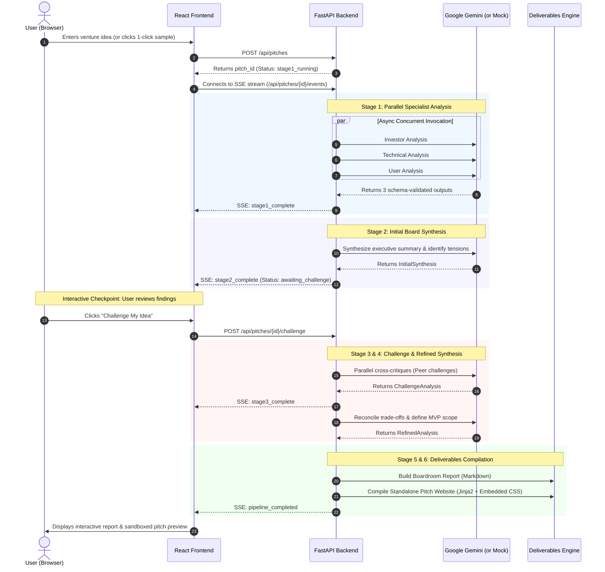

# VentureLens: Technical Architecture & Implementation Report

**Document Purpose:** A clear, plain-English explanation of the technology stack, multi-agent architecture, LLM usage, and engineering design decisions behind VentureLens.

---

## 1. Executive Summary in Plain English

Most AI startup tools are simply "ChatGPT with a prompt" — you submit an idea, and a single language model generates a polite, generic paragraph praising your concept. This fails in the real world because a single prompt suffers from **confirmation bias** and cannot rigorously simulate the conflicting priorities of business investors, software engineers, and everyday users.

**VentureLens** solves this by modeling a collegiate advisory board:
- Three specialized AI agents examine the venture through isolated, non-overlapping perspectives.
- A **Board Chair Agent** coordinates their findings, identifies where they agree, and pinpoints where their recommendations clash.
- In a dedicated second stage called **"Challenge My Idea"**, the agents cross-examine each other's assumptions.
- Finally, the Board Chair resolves these trade-offs into an authoritative **Refined Analysis**, which compiles into two deliverables: a structured **Boardroom Report** and an offline-ready **Static Pitch Website**.

---

## 2. Multi-Agent System Architecture

### 2.1 The Four Boardroom Personas

```
+-----------------------------------------------------------------------------------------+
|                                    VENTURELENS BOARDROOM                                |
|                                                                                         |
|  +-----------------------+  +-----------------------+  +-----------------------------+  |
|  |     INVESTOR AGENT    |  |    TECHNICAL AGENT    |  |         USER AGENT          |  |
|  |  Commercial Viability |  |  Feasibility & Stack  |  |    UX & Adoption Friction   |  |
|  |  Revenue & Unit Econ  |  |  MVP Scope Boundaries |  |    Personas & Pain Relief   |  |
|  +-----------------------+  +-----------------------+  +-----------------------------+  |
|             │                           │                            │                  |
|             └───────────────────────────┼────────────────────────────┘                  |
|                                         ▼                                               |
|                             +-----------------------+                                   |
|                             |      BOARD CHAIR      |                                   |
|                             |  Workflow Coordinator |                                   |
|                             |  Synthesizer & Verdict|                                   |
|                             +-----------------------+                                   |
+-----------------------------------------------------------------------------------------+
```

1. **Investor Agent (Commercial & Business Viability):**
   - *System Prompt:* Senior venture capitalist.
   - *Focus:* Market size, willingness to pay, pricing models, defensibility/moats, customer acquisition costs (CAC), and commercial churn risks.
   - *Guiding Question:* "Can this idea make money, sustain healthy margins, and survive against incumbents?"
2. **Technical Agent (Architecture & Engineering Feasibility):**
   - *System Prompt:* Principal software architect / CTO.
   - *Focus:* Practical feasibility, tech stack recommendation, system architecture, security/scaling bottlenecks, and strictly scoping an MVP.
   - *Guiding Question:* "Can an early-stage team realistically build and maintain this without drowning in technical debt?"
3. **User Agent (UX & Adoption Friction):**
   - *System Prompt:* Head of product and user research.
   - *Focus:* Target personas, pain point severity, habit inertia, onboarding friction, and essential user-facing features.
   - *Guiding Question:* "Will real humans actually adopt this, or will onboarding friction cause them to abandon it?"
4. **Board Chair Agent (Executive Orchestration & Synthesis):**
   - *System Prompt:* Independent advisory board chair.
   - *Focus:* Synthesizing findings, highlighting agreements, exposing conflicting recommendations, chairing the challenge round, and rendering the final verdict.
   - *Guiding Question:* "What are the definitive trade-offs we must make to give this venture the highest probability of success?"

---

### 2.2 Why Genuine Multi-Agent Separation Matters

In VentureLens, multi-agent is an architectural reality, not a marketing buzzword:
- **Independent Context Windows:** Each specialist agent receives its own dedicated system prompt and runs in an isolated LLM execution call. The Investor Agent does not see the Technical Agent's prompt while forming its first opinion.
- **Strict Pydantic Output Schemas:** Every agent outputs validated JSON conforming to a dedicated schema (e.g. `InvestorAnalysis`, `TechnicalAnalysis`).
- **Creative Tension:** Because agents have different objectives, they naturally produce conflicting recommendations. For example, the Investor wants enterprise identity verification and immediate monetization; the User Agent warns that verification causes drop-off; the Technical Agent warns that enterprise billing will delay launch by 3 months.

---

## 3. Technology Stack Breakdown

| Tier | Technology | Why It Was Chosen |
|---|---|---|
| **Frontend Framework** | **React 18 + Vite** | Instant Hot Module Replacement (HMR), component-driven state, and lightweight execution without the SSR overhead of Next.js. |
| **Styling & Design** | **Tailwind CSS** | Utility-first CSS providing a clean, calm, modern boardroom aesthetic with zero external CSS download latency. |
| **Iconography** | **Lucide React** | Lightweight, consistent SVG iconography for boardroom member domains and status indicators. |
| **Backend Framework** | **Python + FastAPI** | Native asynchronous execution (`asyncio`), high-speed request processing, automatic OpenAPI docs, and seamless Pydantic integration. |
| **Streaming Protocol** | **Server-Sent Events (SSE)** | One-way event streaming from backend to frontend. Significantly simpler and more reliable than WebSockets for pipeline stage notifications. |
| **Template Engine** | **Jinja2** | Compiles structured JSON into a single-file presentation website with 100% embedded CSS and zero external CDN links. |
| **LLM SDK** | **Google GenAI SDK (`google-genai`)** | The official Google SDK supporting native structured schema output (`response_schema=PydanticModel`). |
| **AI Model** | **`gemini-3.5-flash-lite`** | High throughput, low latency, cost-effective, and fully capable of returning strict, schema-validated JSON. |
| **State Storage** | **In-Memory Thread-Safe Dict** | Simple, fast, and dependency-free for local university demonstrations (no database setup required). |

---

## 4. Why We Chose Native Python `asyncio` Over LangGraph or CrewAI

A common question in AI software engineering is: *"Why not use LangGraph, AutoGen, or CrewAI?"*

Our architectural decision to use **native Python `asyncio`** was deliberate:
1. **Deterministic Execution:** VentureLens follows a clear, multi-stage Directed Acyclic Graph (DAG):
   - `Stage 1 (Parallel Specialists) -> Stage 2 (Initial Synthesis) -> Stage 3 (Parallel Cross-Critique) -> Stage 4 (Final Synthesis) -> Stage 5 & 6 (Deliverables)`.
2. **Zero Framework Bloat:** LangGraph and CrewAI introduce massive dependency trees, rapid breaking API changes, and complex black-box state graphs that frequently fail during live presentations.
3. **True Asynchronous Concurrency:** Using `asyncio.gather(investor_task, tech_task, user_task)` runs all three specialist agents simultaneously over the network, cutting Stage 1 execution time from ~15 seconds to ~5 seconds.
4. **100% Inspectable & Testable:** Every agent call, retry, and schema validation step is standard, readable Python code that can be debugged with standard tools and covered by `pytest`.

---

## 5. Structured Data Contracts & LLM Reliability

### 5.1 Enforcing Zero JSON Hallucinations
A frequent failure of LLM applications is receiving malformed JSON (missing quotes, markdown code blocks, or missing keys).

VentureLens solves this at the protocol level:
```python
response = await client.aio.models.generate_content(
    model="gemini-3.5-flash-lite",
    contents=user_prompt,
    config=types.GenerateContentConfig(
        system_instruction=INVESTOR_AGENT_SYSTEM_PROMPT,
        response_mime_type="application/json",
        response_schema=InvestorAnalysis, # Pydantic Model!
    ),
)
```
The Gemini model's output decoder is constrained to emit tokens that strictly adhere to the Pydantic JSON schema.

### 5.2 Two-Layer Resilience & The Deterministic Mock Mode
To guarantee that a live classroom demonstration never fails due to API limits or campus Wi-Fi drops:
1. **Single-Retry Handler:** If a live call fails, the provider waits 1 second and retries automatically.
2. **Graceful Fallback:** If live calls fail twice (or if `LLM_MODE=mock` is set), the engine activates `MockProvider`.
3. **Deterministic Mock Mode:** Returns pre-computed, schema-valid analyses for the entire pipeline in under 1 second without hitting external networks or consuming API quotas.

---

## 6. The Pipeline Stages & Data Flow



---

## 7. Deliverables Engineering

### 7.1 Boardroom Report
- Compiled as a structured Markdown document covering 10 standardized sections (Executive Summary, Venture Foundation, Initial Specialist Outlooks, Validated Strengths, Critical Risks, Peer Cross-Critiques, Resolved Trade-Offs, Refined Recommendations, Actionable MVP Specification, and Disclaimer).
- Offers one-click copy, direct `.md` file download, and clean browser printing (`@media print` CSS).

### 7.2 Standalone Static Pitch Website
- Built with a Jinja2 template (`backend/app/templates/pitch_site.html`).
- **Genuinely Standalone:** Contains **100% embedded CSS** within `<style>` tags. Zero `<script>` tags, zero external fonts (`fonts.googleapis.com`), and zero CDN stylesheets.
- Rendered safely in the frontend inside a sandboxed `<iframe>` (`allow-same-origin allow-scripts`) with a responsive Desktop/Mobile viewport switcher.
- Downloadable as a single `.html` file that can be sent via email or hosted on any web server without a backend.
